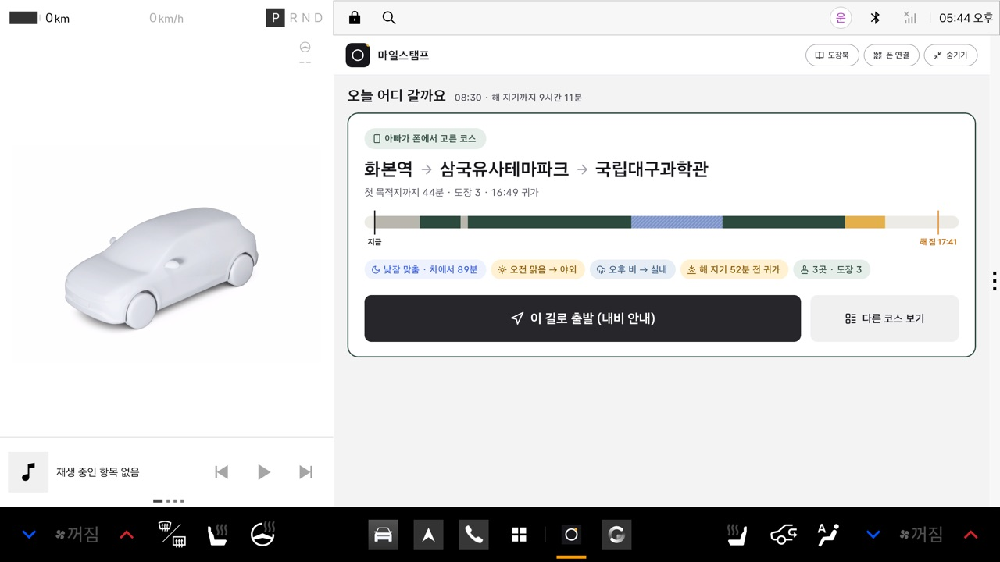
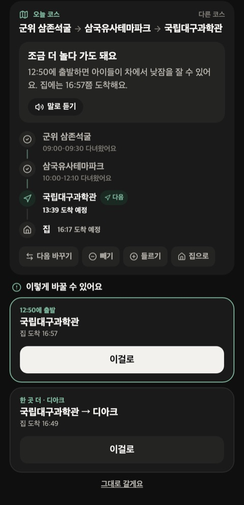
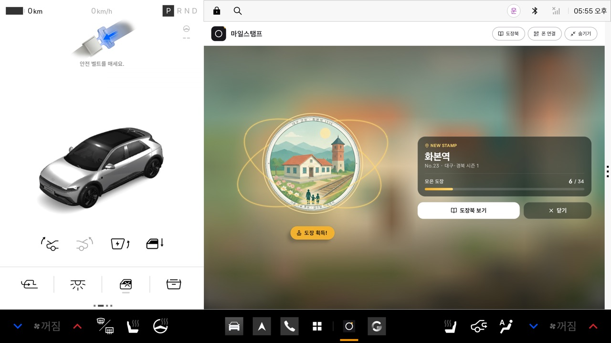
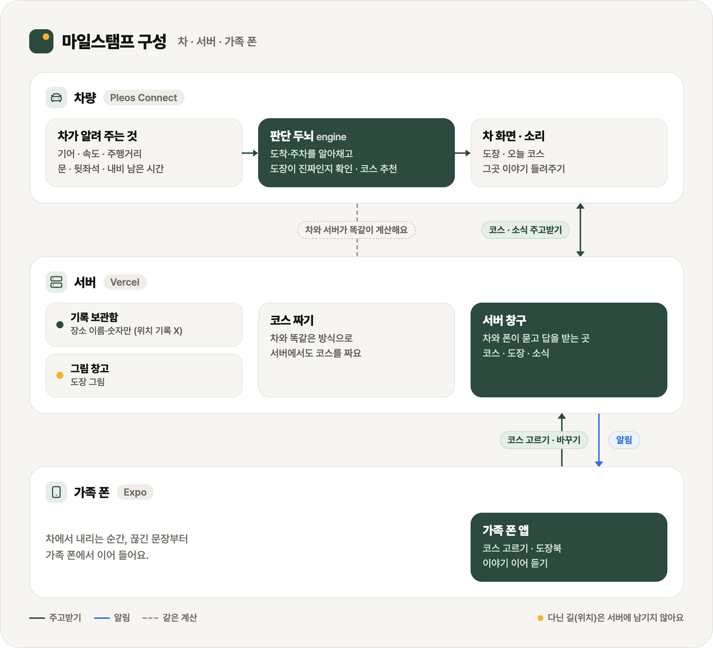
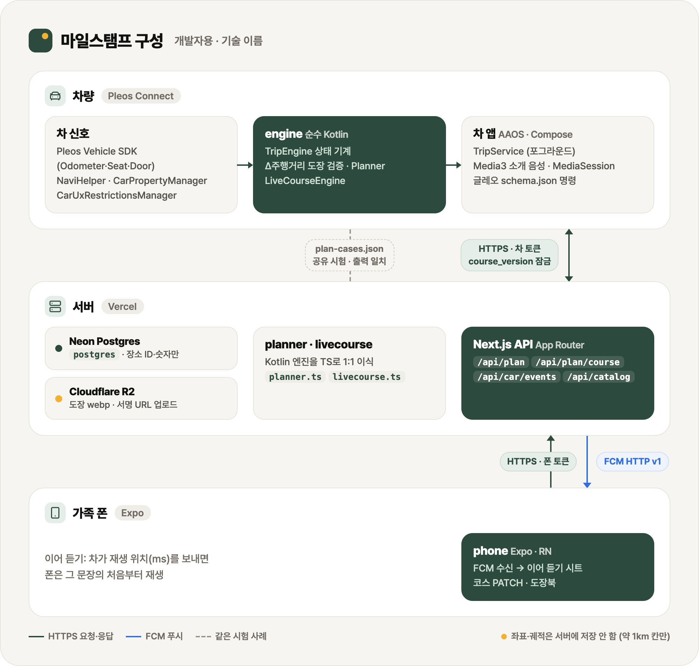

<div align="center">

# 마일스탬프 · MileStamp

**가족이 나들이 가면, 차가 알아서 도장을 찍어 주는 앱**

Pleos Connect 차량용 앱 · 2026 현대자동차그룹 차량용 앱 개발 공모전 출품작 (이동 서비스)


[시연 영상](#시연-영상-2분-23초) · [APK](#apk) · [빠른 체험](#3-빠른-체험-약-3분--release-앱--가상-콘솔만) · [구성](#구성) · [Pleos SDK](#pleos-sdk--차량-api-사용) · [테스트](#테스트) · [개인정보](#개인정보)

</div>

<br>

<table align="center">
  <tr>
    <td align="center"><br><sub>차 화면 · 오늘 어디 갈까요</sub></td>
    <td align="center" rowspan="2"><br><sub>가족 폰 · 살아 있는 코스</sub></td>
  </tr>
  <tr>
    <td align="center"><br><sub>차 화면 · 도장 획득</sub></td>
  </tr>
</table>

## 한눈에

아이와 주말 나들이를 가는 가족을 위한 앱입니다.

| 언제 | 마일스탬프가 하는 일 |
|---|---|
| **출발 전** | 귀가 목표 시각 · 아이 낮잠 · 날씨 · 해 지는 시각에 맞춰 오늘 코스 3개를 추천해요 |
| **도착 2분 전** | 내비를 가리지 않도록 **화면 대신 소리로** 그곳 이야기를 들려줘요 |
| **차를 세우면 (P단)** | **누적 주행거리로 실제로 달려왔는지 검증한 도장**을 찍어요 — 위치만 바꾼 위조는 '보류' |
| **가는 동안** | 늦어지거나 비가 오면 코스를 그때그때 다시 짜요 (살아 있는 코스) |
| **내리는 순간** | 차에서 듣던 이야기를 가족 폰에서 끊긴 문장부터 이어 들어요 |
| **집에 오면** | 오늘 요약과 **뒷좌석 아이 확인** 알림으로 하루를 마쳐요 |

## 시연 영상 (2분 23초)

https://github.com/user-attachments/assets/f122af62-b03f-423c-bce4-58a10a4af708

<sub>Pleos Connect 에뮬레이터 하루 시나리오(코스 → 도장 → 이어 듣기 → 다시 짜기 → 귀가·뒷좌석 → 위조 보류) + 가족 폰 이어 듣기 · 파일로 받기: <a href="docs/video/milestamp-demo.mp4"><code>docs/video/milestamp-demo.mp4</code></a></sub>

## APK

| 앱 | 파일 | 패키지 | 대상 |
|---|---|---|---|
| 차량 앱 (심사 대상) | [`apk/큐비온_마일스탬프_release.apk`](apk/) | `kr.milestamp.car` | Pleos Connect (AAOS, API 28+) |
| 가족 폰 앱 (함께 쓰는 앱) | [`apk/마일스탬프_가족폰_release.apk`](apk/) | `kr.milestamp.phone` | 안드로이드 폰 (API 24+, arm64) |

> 둘 다 release 빌드이며 같은 release 키로 서명했습니다. 차량 앱은 R8(코드 줄이기)·리소스 줄이기를 켠 빌드이고, 운영 서버 `https://milestamp.vercel.app`에 붙습니다.

## 구성

<p align="center"></p>

<p align="center"><b>개발자용 · 기술 이름</b></p>

<p align="center"></p>
<p align="center"><sub>글로 된 원본(mermaid): <a href="docs/diagrams/architecture.mmd"><code>docs/diagrams/architecture.mmd</code></a></sub></p>

| 폴더 | 내용 |
|---|---|
| `engine/` | 안드로이드와 무관한 순수 Kotlin 판정 엔진. `TripEngine.handle(SignalEvent): List<Effect>` — 대기 → 계획 → 주행 → 도착 임박 → 주차 → 하차 → 귀갓길 → 집. 도장 검증 `0.9×직선 − 1 ≤ Δ주행거리 ≤ 1.5×경로 + 20`, 추천, 살아 있는 코스 |
| `app/` | 차량 앱. 차 신호 연결, 포그라운드 서비스, 소개 음성(Media3·MediaSession), 옆 창 화면(Compose), 글레오 음성 명령 |
| `web/` | 서버 + 관리자 화면 (Next.js · Postgres · FCM · R2). 엔진의 추천·코스 규칙을 TypeScript로 이식 |
| `phone/` | 가족 폰 앱 (Expo SDK 58 · React Native) |
| `tools/` | 심사용 빠른 체험·시연 대본 `demo/`, 에뮬레이터 설치 `emulator/`, 시험 자료 `kto100/` |
| `apk/` | 제출 APK (차량 앱 · 가족 폰 앱) |
| `docs/` | README 그림·구성도·시연 영상 |

## Pleos SDK · 차량 API 사용

| 기능 · 앱에서 하는 일 | 사용한 API |
|:---|:---|
| **누적 주행거리**<br>도장 검증 — 장소 사이 실제 달린 거리가 경로와 맞는지 | Pleos **Vehicle SDK 2.3.2**<br>`Odometer.registerDistanceDriven`<br><sub>권한 `pleos…CAR_DRIVE`</sub> |
| **2열 탑승**<br>집 도착 시 뒷좌석 아이 확인 알림 | Vehicle SDK<br>`Seat.registerSeatOccupancy(ROW_2_*)`<br><sub>권한 `pleos…CAR_SEATS`</sub> |
| **운전석 문**<br>하차 순간 → 듣던 이야기를 가족 폰으로 | Vehicle SDK<br>`Door.registerDoorPosition(ROW_1_LEFT)`<br><sub>권한 `pleos…CAR_DOORS`</sub> |
| **남은 시간·위치**<br>도착 2분 전 소개 음성, 귀가 시각 다시 계산 | Pleos **NaviHelper 3.0.5**<br>`onDestinationInfo` · `onTripInfo` · `onCurrentLocationInfo`<br><sub>권한 `pleos…NAVI_ROUTE`</sub> |
| **경유지 길 안내**<br>고른 코스를 내비에 한 번에 | NaviHelper<br>`requestRouteWithWaypoints` (경유지 2곳)<br><sub>권한 `pleos…NAVI_ROUTE_SEARCH`</sub> |
| **기어·속도**<br>P단 3초 = 주차, 주행/정차 판단 | AAOS `CarPropertyManager`<br>`GEAR_SELECTION` · `PERF_VEHICLE_SPEED`<br><sub>권한 `CAR_POWERTRAIN` · `CAR_SPEED`</sub> |
| **주행 중 제한**<br>주행 중엔 옆 창 대신 칩 한 줄 + 음성 한 문장 | AAOS `CarUxRestrictionsManager` |
| **음성 명령**<br>3개(Pleos 최대 3개): 다음 갈 곳 추천 · 이곳 이야기 듣기 · 도장북 열기 | **Gleo** `assets/schema.json` |

> FusedLocation·TTS SDK는 Playground에서 '준비 중'이라 각각 내비 위치 + 안드로이드 기본 위치, 미리 만든 MP3(Media3)로 대신했습니다. 오디오 포커스·음성 앞 무음 150~200ms·뒤로 가기 = `moveTaskToBack(true)` 규칙을 지킵니다.

## 실행 방법

> **빨리 보시려면:** 1·2번(에뮬레이터 · 차량 앱 설치) 뒤 **3번 빠른 체험**을 실행하세요. 폰·debug 빌드 없이 release 앱만으로 추천 → 도장 → 귀가 요약 → 뒷좌석 확인 → 위조 보류까지 약 3분입니다.
>
> **위치를 대구로 옮겨 주세요.** 명소·식당·축제가 **대구·경북 시범 지역**에 있습니다. 에뮬레이터 기본 위치(판교)에서는 가까운 명소가 없어 추천이 '바로 집으로' 한 장만 나오고, 차 화면 위에 '지금은 대구·경북 시범 지역에서 추천해요' 안내가 뜹니다. 3번 대본은 위치를 대구로 옮겨서 시작합니다.

### 1. 에뮬레이터 준비
1. Android Studio (Ladybug 이상), JDK 17, Android SDK API 34
2. **Pleos Connect Emulator v2.1.0** AVD를 콜드 부트로 실행 (RAM 4GB 권장). Apple Silicon 맥에서는 `bash tools/emulator/setup-pleos-emulator-v4.sh`로 에뮬레이터·이미지 설치와 AVD 생성·실행을 한 번에 할 수 있습니다(Android Studio 필요).
3. 가상 콘솔: `adb forward tcp:8088 tcp:8088` 후 브라우저에서 http://127.0.0.1:8088 — 기어 P/D, 속도, 누적 주행거리, 운전석 문, 2열 좌석을 바꿀 수 있습니다.

### 2. 차량 앱 설치
```bash
adb install -r "apk/큐비온_마일스탬프_release.apk"
# 앱은 차 사용자(보통 user 10)로 실행됩니다. 처음 실행 때 위치·속도 권한을 허락해 주세요.
# 권한 창이 잘 안 눌리면:
adb shell pm grant --user 10 kr.milestamp.car android.car.permission.CAR_SPEED
adb shell pm grant --user 10 kr.milestamp.car android.permission.ACCESS_FINE_LOCATION
```
앱 목록의 **마일스탬프**를 열면 먼저 대기 화면('차에 타면 오늘 추천을 보여 드려요')이 나옵니다. **차에 타면**(가상 콘솔에서 2열 좌석 착좌) 지금 시각·해 지는 시각·귀가 한계에 맞춘 추천 카드가 나옵니다 — 아침·낮이면 '오늘 어디 갈까요', 늦은 오후·저녁이면 '저녁 산책 어때요?', 밤이면 '내일 코스'. 기어를 D → P로 바꾸고 3초가 지나면 주차로 판단합니다. `adb logcat -s MileStamp`로 신호 연결 상태(●)·신호·효과를 한 줄씩 볼 수 있습니다.

### 3. 빠른 체험 (약 3분 · release 앱 + 가상 콘솔만)
```bash
bash tools/demo/judge_tour.sh          # 단계마다 화면을 보고 Enter
AUTO=1 SHOTS=/tmp/judge bash tools/demo/judge_tour.sh   # 기다리지 않고 끝까지 + 단계마다 화면 캡처
```
| 단계 | 대본이 하는 일 | 차 화면 |
|---|---|---|
| 0 준비 | 위치를 대구 '집'(북구청)으로, 기어 P · 빈 좌석 | 대기 화면 |
| 1 탑승 | 2열 좌석 둘 다 착좌 | 지금 시각에 맞춘 추천 카드 (코스 · 이유 칩 · 하루 막대) |
| 2 출발 | 기어 D · 50km/h | 버튼 없는 주행 화면 (시스템이 '주행 중에는 사용할 수 없습니다'로 덮을 수 있음 — 주행 제한) |
| 3 도착 | 누적 주행거리 +16km → 디아크로 이동 → P | 누적 주행거리로 검증한 '쾅' 도장 |
| 4 귀가 | 주행거리 +16km → 집에서 P → 아이가 앉은 채 운전석 문 열기 | '오늘 하루' 요약 → 빨간 '뒷좌석에 아이가 있어요' |
| 5 위조 시도 | 주행거리는 그대로 두고 위치만 70km 밖 명소로 → P | 도장 '보류' (주행거리가 이동거리와 맞지 않아요) |

**체험 시각:** 추천 카드는 **오후 7시 30분까지** 나옵니다(아이와 기본 설정 — 잠자는 시간 오후 9시의 90분 전, 해 진 뒤부터는 '저녁 산책' 카드). 그 뒤에 타면 '오늘은 늦었어요 · 내일 코스' 안내가 나오고, 도장·귀가 요약·뒷좌석 확인·위조 보류는 그대로 체험할 수 있습니다.

bash·`adb`·`curl`·`python3`가 필요합니다. 손으로 하실 때는 같은 일을 가상 콘솔 화면(http://127.0.0.1:8088)과 위치 명령으로 하면 됩니다:
```bash
adb emu geo fix 128.5828 35.8858     # 대구 '집'(북구청) — 경도 위도 순서. 앱을 켠 뒤 한 번 더 (내비가 처음에 판교를 보냄)
adb emu geo fix 128.46817 35.83908   # 디아크 (도장 명소)
```

### 4. 가족 폰 앱 (선택)
```bash
adb -s <폰 기기> install -r "apk/마일스탬프_가족폰_release.apk"
```
차 화면 머리줄 **'폰 연결'**(정차 중)의 QR을 폰 앱으로 찍으면 같은 차의 가족이 됩니다. 차 없이 폰 앱만 보시려면 처음 연결 화면에서 **심사용 통과 코드**를 넣으면 시험용 '데모 차'에 연결됩니다 — 코드는 접수 서류로 따로 전달드립니다(저장소에는 적지 않습니다). 데모 차에서는 '개발' 탭에서 하루 시나리오 재생·추천 시험·코스 시험을 할 수 있습니다.

### 5. 시연 대본 (소스에서 빌드한 debug 앱 + 에뮬레이터)
에뮬레이터에서는 내비 위의 위치가 움직이지 않아서, 시연은 가상 콘솔(기어·속도·주행거리·문·좌석)과 debug 빌드 전용 디버그 입력(시계·날씨·내비 남은 시간)으로 하루를 재현합니다.
```bash
./gradlew :app:assembleDebug -PserverUrl=https://milestamp.vercel.app
adb install -r app/build/outputs/apk/debug/app-debug.apk
cd tools/demo
./day_story.sh           # 하루 시나리오: 폰에서 코스 고름 → 도장 4개(쉿·비 오는 날 희귀 포함) → 귀가 요약 → 뒷좌석 → 위조 보류
./live_course.sh         # 살아 있는 코스: 30분 일찍 출발 → 제안 카드 채택 → 폰에서 빼기 → 지금 집으로
./afternoon_story.sh     # 평일 오후: 어린이집 픽업 후 가까운 공원 → 바로 집으로
SHOTS=/tmp/shots ./day_story.sh 6 9   # 장면 일부만 + 장면마다 캡처
```
환경 변수 `SERIAL`(에뮬레이터, 기본 `emulator-5556`) · `SERVER` · `SHOTS` · `FAST=1`. 대본은 `/api/car/pair`로 '폰'(curl)을 자동 연결하며, 시각을 정해 계획을 받으려면 서버에서 그 차가 데모 차여야 합니다.

디버그 입력 예 (debug 빌드만):
```bash
adb shell am broadcast -p kr.milestamp.car -a kr.milestamp.DEBUG --es type CLOCK --es now 08:30
adb shell am broadcast -p kr.milestamp.car -a kr.milestamp.DEBUG --es type ETA --ei remain_s 140 --ei remain_m 1800
adb shell am broadcast -p kr.milestamp.car -a kr.milestamp.DEBUG --es type COURSE_EVENT --es json '{"type":"Skip","place":"dgsm"}'
```
`type`: CLOCK · ETA · ODO_ADD · ODO · WEATHER · SUN · GEAR · SPEED · REAR · DOOR · LOC · COURSE · CHOOSE · PICK · PLAN_SYNC · COURSE_EVENT · ADOPT · RESET_DAY

### 6. 소스에서 빌드
```bash
./gradlew :engine:test :app:assembleDebug          # 차 앱 (JDK 17)
./gradlew :app:assembleRelease                     # release (서명 값은 아래)
cd web && npm ci && npm test                       # 서버 시험
cd phone && npm ci && npx expo prebuild -p android --no-install \
  && cd android && ./gradlew assembleRelease -PreactNativeArchitectures=arm64-v8a
```

release 서명 키는 저장소에 없습니다. `~/.gradle/gradle.properties`(또는 환경 변수)에 `MILESTAMP_STORE_FILE` · `MILESTAMP_STORE_PASSWORD` · `MILESTAMP_KEY_ALIAS` · `MILESTAMP_KEY_PASSWORD`를 넣으면 차 앱과 폰 앱이 함께 씁니다. 없으면 차 앱은 서명 없는 APK, 폰 앱은 debug 키로 만들어집니다.

## 테스트 환경

| 항목 | 내용 |
|---|---|
| 개발 PC | macOS (Apple Silicon), Android Studio 내장 JBR 17 |
| 차량 | **Pleos Connect Emulator v2.1.0** (Android 14 / API 34, AAOS, arm64), 옆 창 841×1209 · 넓게 1706×1210 |
| 차 앱 빌드 | AGP 8.8.2 · Gradle 8.10.2 · Kotlin 2.0.0 · compileSdk/targetSdk 34 · **minSdk 28** (Pleos 샘플 앱 기준선) |
| 가족 폰 | Android 에뮬레이터(API 36) + 실제 안드로이드 폰, Expo SDK 58 · React Native 0.88 · minSdk 24 · targetSdk 36 |
| 서버 | Vercel (Next.js 16.4) + Neon Postgres + Cloudflare R2 + Firebase Cloud Messaging |

## 테스트

| 묶음 | 통과 | 확인하는 것 |
|:---|:---|:---|
| **엔진** · Kotlin JUnit | ✅ 59 | 도장 검증 규칙 · 하루 시나리오 · 살아 있는 코스 · 추천 · 밥 자리 · 저녁 모드 · 도착 지점 · 해 시각 |
| **차 앱** · JUnit | ✅ 64 | 주행·정차 판정 · 화면 규칙 · 코스 단계 · 서버 응답 읽기 · 화면 글 · 글레오 스키마(3개 이하·매니페스트 일치) |
| **서버** · TypeScript node:test | ✅ 393 | 코스 · 추천 · 날씨·해 · 밥 자리 · 목록·관리자 · 고르기 · 이유 문장 |
| **엔진 ↔ 서버** | 같은 답 | `plan-cases.json`·`plan-live-cases.json`을 Kotlin·TS가 함께 읽어 카드 제목·순서·귀가 시각·칩 글자까지 비교 |
| **화면·흐름** | 대본 3개 | `tools/demo/*.sh` — 에뮬레이터 + 실제 서버로 처음부터 끝까지, 장면마다 확인 |
| **심사 규칙** | 자체 점검 | release 실측, 아래 표 |

```bash
./gradlew :engine:test                 # 엔진
./gradlew :app:testDebugUnitTest       # 차 앱
cd web && npm test                     # 서버
```

**Pleos 심사 규칙 실측** (차량 앱 release, Pleos Connect Emulator v2.1.0)

| 규칙 | 기준 | 측정 |
|:---|:---|:---|
| 실행 시간 (콜드 스타트) | 10초 이내 | 1.1~3.6초 |
| CPU · 주행 중 | 5% 미만 | 0.2~0.6% |
| CPU · 정차 중 | 25% 이하 | 0.3% |
| 메모리 (PSS) | 400MB 이하 | 37~38MB |
| 뒤로 가기 | `moveTaskToBack(true)` | 종료 없이 뒤로 숨김 |
| 오디오 포커스 · 음성 앞 무음 | 정책 준수 · 150~200ms | Media3 포커스 요청 · 무음 0.18초 |
| 주행 중 팝업 · 글레오 함수 | 금지 · 최대 3개 | 정차 중에만 앞으로 · 3개 |

## 개인정보

- 공개 문서 (서버 `web/`, 로그인 없이 누구나):
  - 개인정보처리방침 — https://milestamp.vercel.app/privacy
  - 위치기반서비스 이용약관 — https://milestamp.vercel.app/location-terms
  - 함께(가족 커뮤니티) 이용 규칙 — https://milestamp.vercel.app/community-rules
  - 가족 폰 앱 '우리 차' 탭의 '약관·개인정보' 줄, '함께' 이용 규칙 창, 관리자 화면 아래에서 열 수 있습니다. 차량 앱은 화면에 따로 링크를 두지 않았습니다(위 주소 참고).
- **주행 궤적을 서버에 보내지 않습니다.** 차가 보내는 소식(도장·이어 듣기 등)은 장소 ID와 숫자(도장 번호·주행거리 차이·재생 위치)뿐입니다.
- 추천에 쓰는 지금 위치는 <b>소수 둘째 자리(약 1km 칸)</b>로 깎아 계산하고, 칸 글자('35.89,128.58')만 저장합니다.
- 집 위치는 <b>약 100m(소수 셋째 자리)</b>로만 저장하고, 로그에 좌표를 남기지 않습니다. 시연·소스의 '집'은 공공기관(구청) 좌표입니다.
- 가족 소식은 같은 차에 연결된 가족 폰에만 갑니다. 공개 링크는 가족이 직접 공유한 자랑 카드뿐입니다.
- 폰 위치 권한은 앱을 쓰는 동안만, 배경 위치는 쓰지 않습니다. 비밀 값(DB 주소·키·통과 코드)은 서버 환경 변수에만 있습니다.

## 라이선스 · 함께 쓴 자료

| 자료 | 라이선스 | 쓰는 곳 |
|---|---|---|
| [Lucide](https://lucide.dev) 아이콘 · [compose-icons](https://github.com/composablehorizons/compose-icons) · lucide-react-native | ISC · MIT | 차·폰 화면 아이콘 (`app/NOTICE`) |
| [카카오맵 API](https://apis.map.kakao.com) · 카카오 로컬 · 카카오모빌리티 길찾기 | Kakao 이용 약관 | 지도, 장소 찾기, 실제 길·교통 반영 시간 |
| [Leaflet](https://leafletjs.com) | BSD-2-Clause | 지도 예비(카카오를 못 쓸 때) |
| 지도 타일 © [OpenStreetMap](https://www.openstreetmap.org/copyright) 기여자 | ODbL | 위 예비 지도 (화면에 출처 표시) |
| [Pretendard](https://github.com/orioncactus/pretendard) | SIL OFL 1.1 | 폰 앱 글꼴 |
| [Gowun Batang](https://fonts.google.com/specimen/Gowun+Batang) | SIL OFL 1.1 | 도장 테두리 글씨 |
| Pleos Connect SDK (Vehicle · NaviHelper) | Pleos Playground 이용 약관 | 차량 신호·내비 |
| Expo · React Native · Next.js · Jetpack Compose · Media3 · ZXing 등 | 각 프로젝트 라이선스 (MIT · Apache-2.0) | — |
| 도장 그림 | ChatGPT(이미지 생성)로 만든 원형 풍경 + 직접 그린 잉크 테두리·이름 | 앱 `drawable-nodpi/` |
| 소개 음성 | Fish Audio로 만든 음성 (대본은 직접 작성) | `app/src/main/assets/intro/` |
| 관광지 정보 | 한국관광공사 TourAPI · 각 기관 공개 자료를 참고해 직접 요약 | `web/db/places.seed.json` |

---

<p align="center"><sub>마일스탬프 · 큐비온 · 2026 현대자동차그룹 차량용 앱 개발 공모전</sub></p>
